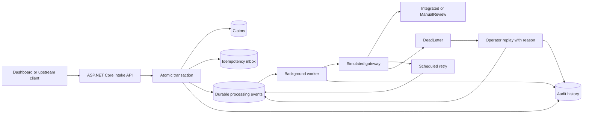

# Healthcare Claims Integration Platform

[](https://github.com/AshokRana25/healthcare-claims-integration/actions/workflows/ci.yml)

**A .NET 10 integration demonstration with durable events, idempotent claim intake, scheduled retries, dead-letter replay, and an operations dashboard.**

An upstream system may send a claim twice, a gateway may fail temporarily, or an operator may need to investigate a failed message. This project makes those integration scenarios visible and testable, using fictional claims and a simulated gateway.

**Synthetic data only.** This is a portfolio reference implementation, not a clinical system, payer connection, payment engine, HIPAA-certified product, or production deployment. Use identifiers beginning `SYN-`; do not enter patient information.

## What it demonstrates

- **ASP.NET Core APIs:** submit claims, inspect status and audit history, replay failed events, and retrieve an OpenAPI specification.
- **Two layers of duplicate prevention:** an `Idempotency-Key` plus a unique `(source, externalClaimId)` business identifier. Reusing either with a changed payload returns HTTP 409.
- **Atomic intake:** claim, idempotency mapping, processing event, and initial audit entry commit in one SQLite transaction.
- **Durable processing:** a background worker polls persisted events. Restarting the process preserves pending work, attempt counts, and retry deadlines.
- **Bounded retries:** temporary failures retry after 2 seconds and then 4 seconds; at most 3 attempts per replay cycle.
- **Exception routing:** permanent failures and exhausted retries enter a dead-letter state. A fictional amount threshold routes successful integrations above USD 5,000 to manual review.
- **Audited replay:** a reason is required; attempts reset while history and the event identifier are retained.
- **Concurrency tests:** parallel duplicate submissions and competing consumers are exercised against a real SQLite database.

## Run the application

Install the [.NET 10 SDK](https://dotnet.microsoft.com/en-us/download/dotnet/10.0), then:

```bash
git clone https://github.com/AshokRana25/healthcare-claims-integration.git
cd healthcare-claims-integration
dotnet restore HealthcareClaims.slnx
dotnet run --project src/Claims.Api --urls http://localhost:5080
```

Open **http://localhost:5080** for the dashboard. The API specification is at **http://localhost:5080/openapi/v1.json**.

The application creates `data/claims.db` relative to the process working directory. Database files are ignored by Git. There are no API keys or external services to configure.

### Docker alternative

```bash
docker compose up --build
```

The dashboard is again at http://localhost:5080. A named volume preserves claims between restarts; the container runs as a non-root user. The port is bound to loopback. Docker packaging is provided; see your local build output for runtime validation.

## A five-minute demonstration

1. Submit a **Normal** claim. Watch it move from `Queued` to `Integrated` and inspect the audit trail.
2. Click **Resend last submission**. The server returns the same claim and records `DuplicateIgnored`, without adding a processing event.
3. Click **New claim ID**, choose **Temporary failure**, and submit. Attempts 1 and 2 schedule retries; attempt 3 succeeds after approximately six seconds plus polling time.
4. Submit a **Repeated failure** claim. It reaches `DeadLetter` after the third attempt.
5. Select that claim, supply a replay reason, and replay it. The audit remains intact. The simulation is unchanged, so a repeated failure will fail again; replay alone does not repair a downstream problem.
6. Submit a **Normal** claim for **6000.00**. It routes to `ManualReview` using the fictional workflow rule. The demo has no manual adjudication screen.

The browser retains the last payload and key in memory so an uncertain request can be resent. If you change a payload, use a new business identifier; existing claims are immutable through the API.

## Architecture



Claims, inbox, events, and audit are separate tables in one SQLite database. The event table is an internal transactional outbox consumed directly by the worker; it is not a RabbitMQ or Azure Service Bus implementation.

The consumer's simulated effects are committed in the same transaction as its state transition. This prevents duplicate **local** effects when workers compete. It does not promise exactly-once delivery to external systems. A real network adapter needs downstream idempotency, a leasing strategy, and explicit handling of ambiguous acknowledgements.

Read [architecture decisions and failure analysis](docs/architecture.md) for the tradeoffs and production extension plan.

## API contract

| Endpoint | Purpose | Main responses |
|---|---|---|
| `POST /api/claims` | Intake with `Idempotency-Key` header | 201 new, 200 duplicate, 400 invalid, 409 conflict |
| `GET /api/claims` | Latest 200 claims | 200 |
| `GET /api/claims/{id}` | Claim, event, and ordered audit | 200, 404 |
| `POST /api/claims/{id}/replay` | Replay a dead-letter claim with a reason | 200, 400, 404, 409 |
| `GET /health` | Process liveness and demo metadata | 200 |
| `GET /openapi/v1.json` | Generated API specification | 200 |

Example request:

```http
POST /api/claims
Content-Type: application/json
Idempotency-Key: example-001

{
  "source": "demo-client",
  "externalClaimId": "DEMO-001",
  "memberId": "SYN-1001",
  "serviceDate": "2026-09-01",
  "amount": 250.00,
  "currency": "USD",
  "scenario": "Transient"
}
```

See [runnable HTTP examples](samples/submit-claim.http). Supported scenarios are `Normal`, `Transient`, `Permanent`, and `Exhaust`. Currency is restricted to USD. Amounts are stored as integer cents; JSON inputs permit at most two decimal places. Equivalent amounts such as `125.5` and `125.50` have the same idempotency fingerprint. IDs are case-sensitive and source/business identifiers are trimmed before hashing.

Idempotency keys are global within this local demo database, not scoped to an authenticated tenant. Production keys and uniqueness constraints must be scoped to the caller's identity and tenant.

## Tests and builds

```bash
dotnet test HealthcareClaims.slnx -c Release
dotnet publish src/Claims.Api -c Release -o artifacts/app
```

Tests exercise atomic intake, idempotent replay, business-key conflicts, canonical money values, competing submissions and workers, restart-safe retry schedules, retry exhaustion, permanent failures, manual-review boundaries, and HTTP validation. A controllable clock advances retries without sleeping. API integration tests use an isolated SQLite database per test.

GitHub Actions restores dependencies, builds, runs tests, publishes the application, and retains test result files. The workflow uses no credentials or healthcare data.

## Project structure

```text
src/Claims.Core/          Claim models, validation, durable store and processing state machine
src/Claims.Api/           HTTP endpoints, worker and browser dashboard
tests/Claims.Tests/       Store/concurrency tests and API integration tests
docs/architecture.md     Decisions, failure scenarios and limitations
samples/                 Synthetic HTTP requests
compose.yml              Local container setup with persistent storage
```

## Operational boundaries

- No real claims standard is implemented: this is not an X12 837/835 parser, FHIR server, or HL7 interface.
- No authentication, role permissions, encryption at rest, tamper-evident audit storage, tenant isolation, or production retention policy is provided. Keep the demo local.
- Audit records are append-only through application behavior, not protected from a database administrator modifying the file.
- A single SQLite database serializes writers. It is intentionally a small demonstration, not a high-throughput distributed queue.
- The dashboard counts only the latest 200 claims. Audit history is unpaginated; large-volume use needs pagination and archival.
- `/health` is a liveness endpoint, not a database/gateway readiness probe.
- Validation errors do not create claims or processing events. Conflicting submissions return 409; they do not mutate existing claims.

## Technologies

C# · .NET 10 · ASP.NET Core Minimal APIs · Microsoft.Data.Sqlite · BackgroundService · xUnit · Docker · GitHub Actions · HTML/CSS/JavaScript

## Reference documentation

- [ASP.NET Core Minimal APIs](https://learn.microsoft.com/en-us/aspnet/core/fundamentals/minimal-apis?view=aspnetcore-10.0)
- [Microsoft.Data.Sqlite transactions](https://learn.microsoft.com/en-us/dotnet/standard/data/sqlite/transactions)
- [.NET background services](https://learn.microsoft.com/en-us/aspnet/core/fundamentals/host/hosted-services?view=aspnetcore-10.0)
